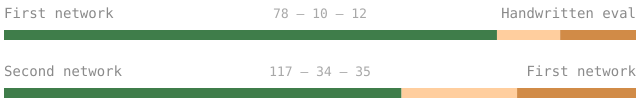
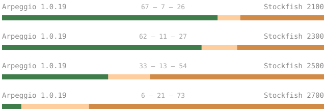

# Arpeggio

In-depth writeup: https://ajkhullar.com/blog/arpeggio

Arpeggio is a chess engine written in C++. At present Arpeggio has an estimated rating of ~2425. 

Arpeggio is compatible with most chess GUIs through UCI, but it also has a simple board of its own built with [SFML](https://www.sfml-dev.org/).

### Specific Optimizations

- **Alpha-beta pruning** stops considering a move once it's clearly worse than one we already have.
- **Move ordering** (MVV-LVA) checks promising captures first, so we eliminate worse moves earlier.
- **Transposition tables** remember positions we've already seen.
- **Quiescence search** follows trades, ensuring correct board analysis
- **Iterative deepening** searches one depth at a time, so there's always a move ready when the clock runs low.

### Board Evaluation

Arpeggio, like so many other chess engines, began with a hand-crafted evaluation function. This was the case for Stockfish until 2020. Hand-crafted eval functions generally use material comparisions and apply bonuses for certain piece positions (e.g. a bonus for keeping the ally king in the board's corner in early-mid game). Now, Arpeggio uses an NNUE (Efficiently Updatable Neural Network) to score board positions. 

Each iteration of the network was trained on 20 million board positions derived from games Arpeggio played against itself. As a result, the first iteration of the network was trained on the handwritten evaluation function, but despite this was able to far surpass it in accuracy. The second network was trained on the first, and once again improved.

Here's how each engine performed against its predecessor (wins - draws - losses):



### Results

Arpeggio's rating is estimated by playing it against Stockfish with its strength limited. Every game was played at 10+0.1s.

| Version | Key Changes                                      | Games | Rating |
| ------- | ------------------------------------------------ | ----- | ------ |
| 1.0.10  | Pruning, quiescence search, transposition tables | 400   | ~1525  |
| 1.0.14  | Move ordering                                    | 800   | ~1950  |
| 1.0.15  | En passant bug fixes                             | 800   | ~2010  |
| 1.0.19  | Neural network                                   | 400   | ~2385  |

Arpeggio's latest version, in a gauntlet against 2100, 2300, 2500 and 2700:



These ratings are on Stockfish's own scale, and are therefore estimates. 

### Setup

Requirements are SFML and a C++17 compiler.

```sh
make       # builds a new version into Engines/
make run   # opens the board
```

To use it in another chess GUI, add the `arpeggio-X.Y.Z.sh` file from the version's folder in `Engines/` as a UCI engine. Run the script, not the binary.

### Thanks

- [Chess Programming Wiki](https://www.chessprogramming.org/), without which I wouldn't have been able to get started
- Sebastian Lague's [Coding Adventure: Chess](https://www.youtube.com/watch?v=U4ogK0MIzqk)
- [bullet](https://github.com/jw1912/bullet), which trained the network
- Stockfish
